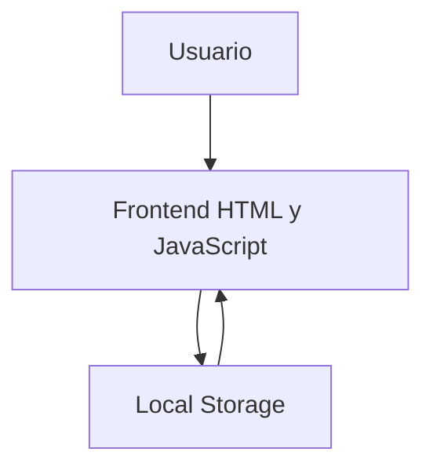

# Tienda TECSUP


Proyecto desarrollado para el Laboratorio 03 del curso Diseno de Interfaces de Programacion Avanzado.

La aplicacion Tienda TECSUP permite visualizar una lista de productos, sus precios y cantidades, asi como calcular automaticamente el importe total de la compra mediante JavaScript.

El proyecto utiliza HTML para la estructura, CSS para los estilos y JavaScript para la funcionalidad.

## Tabla de contenidos

- [Instalacion](#instalacion)
- [Uso](#uso)
- [Estado de las funciones](#estado-de-las-funciones)
- [Hoja de ruta](#hoja-de-ruta)
- [Ejemplos de codigo](#ejemplos-de-codigo)
- [Arquitectura](#arquitectura)
- [Contribucion](#contribucion)
- [Licencia](#licencia)
- [Autor](#autor)

## Instalacion

Para descargar el proyecto y ejecutarlo localmente, sigue estos pasos:

```bash
git clone https://github.com/victor-villalva/tienda-tecsup.git
cd tienda-tecsup
```

## Uso
La aplicación permite visualizar los productos, consultar sus precios y cantidades, y calcular el importe total de la compra.

## Tabla de productos

| Producto | Precio | Cantidad |
|:---------|:------:|--------:|
| Polo TECSUP | S/ 25.00 | 2 |
| Taza TECSUP | S/ 18.00 | 1 |

## Estado de las funciones

| Funcion | Estado |
|:---|:---|
| Visualizar productos | Completado |
| Mostrar precios y cantidades | Completado |
| Calcular el total de compra | Pendiente |
| Guardar datos con localStorage | Pendiente |

## Lista de tareas

- [x] Crear la estructura HTML
- [x] Diseñar los estilos CSS
- [ ] Calcular el total
- [ ] Guardar con localStorage

## Hoja de ruta

- [x] Crear la estructura HTML.
- [x] Diseñar los estilos CSS.
- [ ] Implementar el cálculo automático del total.
- [ ] Implementar el almacenamiento con localStorage.
- [ ] Mejorar la documentación del proyecto.
- [ ] Publicar los cambios en GitHub.

## Ejemplos de código por lenguaje

### HTML

```html
<h1>Tienda TECSUP</h1>
<p>Bienvenidos a nuestra tienda.</p>
```

### JavaScript
```javascript
function calcularTotal(precio, cantidad) {
    return precio * cantidad;
}
```

### JSON
```json
{
    "producto": "Polo TECSUP",
    "precio": 25.00,
    "cantidad": 2
}
```

## Diagrama de arquitectura



## Contribucion

Las mejoras y sugerencias para el proyecto son bienvenidas.

1. Identificar oportunidades de mejora.
2. Reportar errores mediante Issues en GitHub.
3. Proponer soluciones mediante Pull Requests.

## Licencia

Este proyecto se desarrolla con fines académicos para el curso de Diseño de Interfaces de Programación Avanzado.

## Autor

Desarrollado por Victor Villalva.

GitHub: https://github.com/victor-villalva